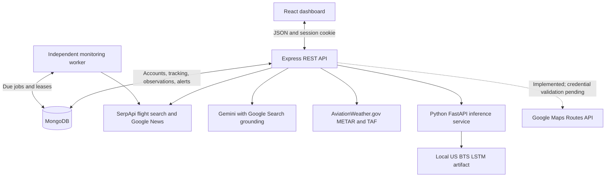

# SkyScout: An Intelligent Flight Price Monitoring and Travel Intelligence Platform

**B.Tech Project Synopsis · Repository review: 30 October 2026**

## 1. Project Title

**SkyScout: An Intelligent Flight Price Monitoring and Travel Intelligence Platform**

## 2. Abstract

Air travellers must often repeat searches to monitor changing ticket prices while consulting separate sources for weather, operational developments and destination conditions. SkyScout addresses this fragmented workflow through a web application that connects flight discovery, personal fare tracking and explainable travel information. Users search available itineraries, compare offers, track a selected flight and configure a target fare. A background worker periodically checks the itinerary, preserves genuine price observations and generates persistent notifications when defined conditions are met.

The application uses a React interface, an Express API and MongoDB storage. Flight offers are obtained through SerpApi. Fare Intelligence presents eligible future booking-day scenarios, rupee and percentage changes, interactive graphs and reproducible calculations. Its configured scenario rates are hypothetical assumptions; sufficiently long observation histories support a separate observed-trend mode. Neither mode is presented as a generally validated fare forecast. Gemini with Google Search grounding supplies cited market and event context, while application rules check source support, dates and itinerary relevance. News does not introduce unsupported numerical price adjustments.

A separate Python service provides LSTM-based arrival-delay estimates for represented US domestic nonstop routes. Aviation weather is displayed independently. Airport-to-destination routing is implemented but awaits live credential validation. The project demonstrates a persistent full-stack workflow with explicit data provenance and partial-failure handling. Its practical contribution is the integration and explanation of travel information, rather than a claim of guaranteed savings or universal prediction accuracy.

## 3. Introduction

Flight selection involves price, timing and operational considerations. A fare shown during one search may differ during a later search, and information relevant to the journey can appear in separate weather reports or news sources. SkyScout combines discovery and monitoring with an explanation of what is observed, what is calculated and what remains uncertain. Its dashboard supports continued examination of a selected itinerary rather than treating each search as an isolated interaction.

## 4. Problem Statement

The project addresses repeated manual fare checks and the effort required to connect a selected itinerary with relevant travel information. The engineering problem is to preserve the correct flight identity, obtain later comparable quotes, notify the correct user and present understandable evidence without confusing old prices, hypothetical scenarios or unrelated news with verified predictions. Provider outages and limited data must remain visible without making the entire dashboard unusable.

## 5. Objectives

1. Retrieve and compare genuine one-way, round-trip and connected multi-city offers with validated travel inputs.
2. Persist user-owned itineraries, quote timestamps and target prices.
3. Recheck due itineraries approximately every six hours and avoid duplicate observations and alerts.
4. Present reproducible Day 0–14 scenarios for eligible one-way flights, ending before departure.
5. Retrieve cited events and distinguish itinerary evidence from broader market context.
6. Integrate aviation weather, supported US delay inference and conditional destination routing.
7. Verify ownership, calculation correctness and failure handling through automated and browser checks.

## 6. Existing System and Its Limitations

Established services already provide flight comparison, tracking and price guidance. For example, Google Flights documents both [price tracking](https://support.google.com/travel/answer/6235879) and [fare insights](https://support.google.com/travel/answer/7664728?hl=en-EN). SkyScout does not claim to invent these capabilities or outperform their predictions. Its narrower academic contribution is an inspectable implementation that consolidates a personal tracking workflow, explicit scenario mathematics, cited context and separately scoped delay inference. Its own limitations include dependence on external providers and incomplete evidence for general fare forecasting.

## 7. Proposed System

The workflow is **search → select → track → monitor → analyse → notify**, with weather and destination information available alongside the tracked itinerary. Search results carry short-lived server references. Tracking uses the server's retained result rather than accepting a browser-supplied fare. MongoDB stores the itinerary and observations. Independent dashboard requests obtain fare calculations, market comparisons, research, weather and supported delay estimates.

Search and tracking support all three trip types. Day-wise fare scenarios and comparable-offer analysis currently support **one-way itineraries only**. Routing awaits live Maps credentials; complete grounded-report persistence is permission-gated. These are implementation boundaries, not completed future enhancements.

## 8. System Architecture



The API isolates provider credentials and coordinates independent results. The worker runs outside browser requests. ML training is an offline process; the inference service loads an evaluated artifact. Complete grounded research is stored only when the application’s storage-authorization setting permits it. MongoDB transactions require a replica set or sharded deployment.

## 9. Module Description

| Module | Input, processing and output | Technology and status |
| --- | --- | --- |
| Search and comparison | Airports, dates, passengers and cabin are validated; provider segments and ticket totals become sortable, filterable offers. Booking is handed to an external provider. | React, Express, SerpApi; implemented and verified within provider availability. |
| Accounts and dashboard | Credentials establish a server session; owner-scoped queries return tracking records, history and inbox entries. Passwords use salted scrypt hashes. | MongoDB, Node crypto; implemented and verified. |
| Monitoring and alerts | A due record is leased, re-matched and refreshed. A confirmed quote, observation and qualifying price alerts commit together. | Independent Node worker, MongoDB transactions; implemented and verified, without a long-duration deployment study. |
| Fare Intelligence | A real reference quote and selected assumptions produce dated lower, central and upper scenarios and explanations. | Deterministic JavaScript, Recharts; implemented and verified for one-way scope. |
| Event and calendar context | Grounded findings undergo source/date/relevance checks; official national calendar dates supplement the timeline. | Gemini, application rules, sourced static calendars; verified within limited coverage. |
| Delay risk | A supported flight’s schedule and stored route history produce a calibrated arrival-delay probability. | FastAPI, PyTorch; artifact/service checks exist; full preprocessing fidelity remains unverified. |
| Aviation weather | Airport identifiers resolve to stations; current observations and terminal forecasts are normalized separately. | AviationWeather.gov, Axios; implemented and verified for tested stations. |
| Destination journey | Arrival airport and entered destination feed routing and grounded disruption research. | Routes API, Gemini; partially implemented as an end-to-end live feature because routing access and impact validation remain pending. |

## 10. Technologies Used

| Technology | Purpose in SkyScout |
| --- | --- |
| React 19, React Router, Vite | Interactive pages, navigation and frontend build. |
| Tailwind CSS, Lucide React, Recharts | Existing styling, icons and interactive charts. |
| Node.js, Express, Axios | REST endpoints, provider communication and background processing. |
| MongoDB, Mongoose | Persistent documents, indexes, relationships, leases and transactions. |
| SerpApi; Google Gen AI SDK | Flight/news retrieval; grounded event research. |
| Python, FastAPI, PyTorch | Separate validated-input ML inference and offline training. |
| NumPy, pandas | Numerical processing and historical-flight preparation. |
| ESLint, Node test runner, Python unittest, Chrome DevTools Protocol | Static checks, automated tests and browser verification. |

## 11. Methodology and Working Principle

1. **Retrieve:** React sends travel inputs to Express. The backend validates them and normalizes provider offers, retaining opaque selection references.
2. **Persist:** An authenticated tracking request creates a user-linked itinerary and initial observation atomically. Its identity includes travel configuration and flight details.
3. **Monitor:** The worker checks due records every minute, claims an expiring owner-specific lease and normally schedules the next successful check six hours later. It rejects stale or uncertain matches and applies bounded retries.
4. **Notify:** Price drops, target attainment and supported risk-band changes create deduplicated in-app records. Email is not configured.
5. **Explain:** Independent requests return server-calculated scenarios, competing offers, dated events, weather and supported predictions. Failure of one optional provider does not erase independent evidence.

`User` owns `AuthSession` and `TrackedFlight` documents. Each tracked flight connects to `PriceObservation`, `Notification`, `DisruptionPrediction` and fare-analysis records. Owner checks protect private endpoints. HttpOnly sessions, production Secure cookies, origin restrictions and a mutation header support access security.

## 12. Fare Intelligence Methodology

The reference fare is the latest valid observation for the tracked itinerary and currency, with its original timestamp. Booking lead time uses the origin airport’s local calendar date. Eligible future points end at `min(14, daysUntilDeparture − 1)`; today’s or departed flights receive no future booking scenarios.

For scenario series `s` and future day `d`, the implemented calculation is:

```text
P_s(d) = max(1, round(P0 × exp(k_s × d)))
Delta(d) = P_central(d) − P0
DeltaPercent(d) = round(100 × Delta(d) / P0, 2)
```

In assumption mode, `k_s = ln(1 + a_s)`. Normal-market daily assumptions are −0.20%, +0.10% and +0.40% for the lower, central and upper series. Upward and downward controls select other explicitly configured assumptions. They are not learned from Gemini or calibrated market forecasts. For an **illustrative** ₹10,000 reference, Day 4 central value is `round(10000 × 1.001^4) = ₹10,040`: a ₹40 or 0.40% increase.

Observed mode uses the last genuine quote per booking day, bounded daily log changes and their 20th, 50th and 80th percentiles, subject to minimum history requirements. Chronological backtesting compares later actual observations with estimates and a last-price baseline; insufficient samples do not establish accuracy.

Gemini researches operations, economics, demand events and disruptions. Citation support, dates and route relevance determine DIRECT, RELATED or CONTEXT classification; invalid findings are excluded. News, competing offers and sourced calendar dates inform explanations. **Numerical event adjustment is zero** because no quantified causal coefficients are established. Graphs and explanations display the same server outputs, including coefficient provenance and limitations.

## 13. Machine Learning Component

The separate LSTM estimates **arrival delay of at least 15 minutes**, excluding cancelled flights, using US DOT BTS Reporting Carrier On-Time Performance data. This target follows the [BTS delay definition](https://www.transtats.bts.gov/ot_delay/).

The local artifact covers 2023–2025 and 20,588,132 eligible flights. Ten-feature sequences encode departure time, weekday and month with sine/cosine pairs, scheduled duration, distance and two earlier-day route-delay summaries. Training-period standardization and preceding-day history avoid using the target flight’s arrival outcome as an input.

The architecture has ten-step sequences, one 48-unit LSTM layer, dropout of 0.2 and a single output logit. Adam and class-weighted binary cross-entropy train the model. Eight epochs and seed 2025 are recorded. Chronological samples contain 150,000 training, 25,000 calibration and 25,000 test windows. Training ends 11 February 2025; calibration ends 21 July; testing covers 22 July–31 December. Platt scaling and threshold selection use calibration data.

| Recorded held-out metric | Value |
| --- | ---: |
| ROC-AUC | 0.6921 |
| Precision / recall / F1 | 0.3515 / 0.5327 / 0.4235 |
| Brier score / relative Brier skill | 0.1555 / 8.18% |

These values were checked in the existing local evaluation artifact, not generated for this synopsis. ROC-AUC is not percentage accuracy. Inference requires represented US domestic nonstop airline-route history. Indian flight-level inference is unavailable. Live weather, news and fares are not inputs to the served LSTM. Source review also finds that training encodes whole departure hours while inference includes minutes; this mismatch needs alignment and re-evaluation. Offline metrics do not establish full inference fidelity.

## 14. Expected Outcomes and Applications

Existing evidence demonstrates genuine flight retrieval, persistent tracking, browser interaction, scenario consistency, supported inference and aviation-weather retrieval. The current 104-test JavaScript baseline, lint and build pass. Earlier browser evidence includes three live grounded cards; a later run records provider failure and quota exhaustion. Expected practical benefits are fewer manual checks and clearer interpretation of available information. User savings, production-scale reliability and general fare-prediction accuracy have not been measured.

## 15. Advantages and Distinctive Contributions

The contribution is the integrated engineering workflow: server-bound itinerary identity, durable monitoring, transactional alerts, explainable scenario mathematics, source-screened research and independent ML inference. Explicit separation of observations, assumptions and model outputs makes the implementation inspectable during evaluation. Provider failure handling and user ownership are part of this contribution, alongside the interface.

## 16. Limitations

External quotas and outages affect current fares and research. Future fare scenarios lack general predictive validation and currently exclude combined itineraries. National calendar coverage is limited to India 2026 and US 2026–27. Complete grounded-report storage is disabled without authorization. Maps routing has contract tests but no verified live response in the recorded environment. News cannot prove an ongoing road closure or quantified fare effect. US delay evaluation ends in 2025. Production deployment, load behaviour and long-running reliability remain unverified.

## 17. Future Scope

Priorities are permission-compliant persistent research, live routing and geographic/time-overlap verification, broader sourced calendars, and email or push delivery. Larger genuine fare histories could support calibrated models tested against simple baselines. Verified Indian flight-level datasets could enable separately evaluated regional delay inference. Existing weather-model experiments require an appropriate inference path and further validation before serving. Additional offer providers and measured load testing would extend coverage and operational evidence.

## 18. Conclusion

SkyScout demonstrates how flight search, personal fare monitoring and travel intelligence can share a coherent full-stack workflow. Its strength is explainable integration with preserved observations and explicit uncertainty. The current implementation provides a defensible academic foundation while keeping limited calendar coverage, provider dependencies and prediction boundaries visible.

*Source traceability, implementation classifications and dated evidence are recorded in [the feature verification matrix](SKYSCOUT_FEATURE_VERIFICATION.md). The [viva guide](SKYSCOUT_VIVA_GUIDE.md) explains the same methods through demonstrations and worked examples.*
